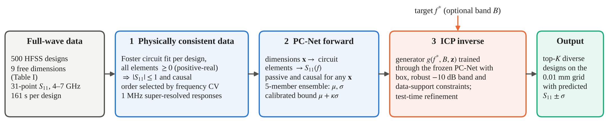

# ICP Antenna Inverse Design

**Inverse, Constrained and Physically Consistent (ICP) learning for the design of a low-profile wideband patch antenna.**
Code, data, trained models and paper of the EuCAP 2027 submission by A. Kumar, P. M. Neelamraju, A. Bansal and W. Whittow (Loughborough University).

You give an S-parameter target, for example *|S11| ≤ −10 dB from 5 to 6 GHz*.
The tool returns HFSS-ready antenna dimensions, the predicted S11 with calibrated uncertainty and, if you ask, an RF equivalent circuit.
Every step, from the 500 raw HFSS files to the tables and figures of the paper, can be rerun with one command.



---

## Contents

1. [Quick start (6 commands)](#1-quick-start-6-commands)
2. [Installation](#2-installation)
3. [Design an antenna from an S-parameter target](#3-design-an-antenna-from-an-s-parameter-target)
4. [Predict S11 for given dimensions](#4-predict-s11-for-given-dimensions)
5. [Run the tests](#5-run-the-tests)
6. [Generate the figures](#6-generate-the-figures)
7. [Reproduce the paper end to end](#7-reproduce-the-paper-end-to-end)
8. [Use your own HFSS data](#8-use-your-own-hfss-data)
9. [Repository layout](#9-repository-layout)
10. [Notation: paper symbols and HFSS variables](#10-notation-paper-symbols-and-hfss-variables)
11. [Troubleshooting](#11-troubleshooting)
12. [Citation and licence](#12-citation-and-licence)

More detail: [method](docs/METHOD.md) · [pipeline steps](docs/PIPELINE.md) · [designer manual](docs/DESIGNER.md) · [results and where every number comes from](docs/RESULTS.md) · [model card](docs/MODEL_CARD.md)

---

## 1. Quick start (6 commands)

Run these from the repository folder. Each command prints what it does and where it writes.

```bash
pip install -r requirements.txt                       # 1. install (see Section 2 for a virtual environment)
python run.py check                                   # 2. is everything in place?
python run.py demo                                    # 3. two-minute tour: design, predict, RF circuit, figures -> demo_output/
python run.py test                                    # 4. 69 tests, about 2 min
python run.py design --band 5 6 --rl 10 --circuit     # 5. your own target: |S11| <= -10 dB over 5-6 GHz, with RF circuit
python run.py reproduce --quick                       # 6. the whole pipeline from the raw HFSS files, about 15 min
```

`run.py` is the single entry point. `python run.py` alone lists every command.

| I want to… | Command | Time |
|---|---|---|
| check the installation | `python run.py check` | 2 s |
| see everything work once | `python run.py demo` | ~2 min |
| run every test | `python run.py test` | ~2 min |
| get dimensions for a band and return loss | `python run.py design --band 5 6 --rl 10` | ~6 s |
| … with the RF equivalent circuit | `python run.py design --band 5 6 --rl 10 --circuit` | ~30 s |
| get dimensions for a centre frequency | `python run.py design --freq 5.5` | ~6 s |
| predict S11 of my own dimensions | `python run.py predict --dims 1.78 11.93 18.61 0.34 4.70 15.35 1.36 2.83 5.07` | 2 s |
| redraw the paper figures | `python run.py figures` | 5 s |
| rerun the whole pipeline quickly | `python run.py reproduce --quick` | ~15 min |
| reproduce the paper exactly | `python run.py reproduce` | ~2 h on 2 cores |
| compare a run with the paper | `python run.py compare quick` | 2 s |
| list the pipeline steps | `python run.py steps` | 1 s |
| compile the paper PDF | `python run.py paper` | 20 s |

---

## 2. Installation

**Requirements.** Python 3.10 or newer on Windows, macOS or Linux. A CPU is enough; no GPU is used. About 1 GB of disk for the packages.

**Step 1. Get the code.**

```bash
git clone https://github.com/<your-account>/ICP-Antenna-Inverse-Design.git
cd ICP-Antenna-Inverse-Design
```

Or unzip the release archive and open a terminal in the unzipped folder.

**Step 2. Create a virtual environment (recommended).**

| System | Commands |
|---|---|
| Windows (PowerShell or cmd) | `python -m venv .venv` then `.venv\Scripts\activate` |
| macOS / Linux | `python3 -m venv .venv` then `source .venv/bin/activate` |
| Anaconda | `conda create -n icp python=3.11` then `conda activate icp` |

**Step 3. Install the packages.** Choose A or B.

```bash
# A. everything: designer, figures, tests and the training pipeline
pip install torch --index-url https://download.pytorch.org/whl/cpu     # CPU build of PyTorch: much smaller than the default
pip install -r requirements.txt

# B. only the designer and the figures (numpy, scipy, matplotlib; no PyTorch)
pip install -r requirements-designer.txt
```

`requirements-lock.txt` lists the exact versions used for the paper. If the first line of A fails, `pip install -r requirements.txt` alone also works (it installs the default PyTorch build).

**Step 4. Check.**

```bash
python run.py check
```

You should see `ready` for every group and `Everything is in place` (with B: `The designer and the figures are ready`).

---

## 3. Design an antenna from an S-parameter target

### 3.1 The command

```bash
python run.py design --band F1 F2 --rl RL [--circuit] [--top K] [--out FOLDER]
```

`python run.py design ...` is the same as `python designer/design_antenna.py ...`.
The designer needs only NumPy (plus SciPy for `--circuit` and matplotlib for the plot).

| Option | Meaning | Default |
|---|---|---|
| `--band F1 F2` | required band in GHz, inside 4–7 GHz | – |
| `--rl RL` | required return loss in dB over the whole band: \|S11\| ≤ −RL dB | 10 |
| `--freq F [F …]` | centre frequency; several values give several runs | asked interactively |
| `--bw B` | required bandwidth around `--freq`, in GHz (`--freq 5.5 --bw 1` = `--band 5 6`) | widest possible |
| `--circuit` | also fit the RF equivalent circuit of each design | off |
| `--top K` | number of diverse designs returned | 5 |
| `--out FOLDER` | output folder | `designs_<target>` |
| `--model FOLDER` | another trained model, e.g. `runs/full/deploy/model` | `designer/model` |

Without options, the tool asks for the target interactively.

### 3.2 Recipes: what to type for typical questions

| Question | Command |
|---|---|
| Which dimensions give \|S11\| ≤ −10 dB from 5 to 6 GHz? | `python run.py design --band 5 6 --rl 10` |
| The same with a 15 dB return loss | `python run.py design --band 5 6 --rl 15` |
| The same, with the RF circuit of each design | `python run.py design --band 5 6 --rl 15 --circuit` |
| The widest −10 dB band centred on 5.8 GHz | `python run.py design --freq 5.8` |
| The widest −15 dB band centred on 5.5 GHz | `python run.py design --freq 5.5 --rl 15` |
| The band of the reported antenna, 4.4–5.4 GHz (Table IV) | `python run.py design --band 4.4 5.4` |
| Several centre frequencies at once | `python run.py design --freq 4.8 5.2 6.0 --top 3 --out my_designs` |
| Only the best design | `python run.py design --band 5 6 --top 1` |
| Regenerate the four shipped examples | `python run.py examples` |

### 3.3 What you get

The console shows the dimensions with paper symbols and HFSS names, and one summary line per design.
For `--band 5 6 --rl 10 --circuit`:

```
=== Target: 5.000-6.000 GHz with |S11| <= -10 dB (return loss >= 10 dB) | 3 designs | 5.6 s ===
       G         W         L        Sx        Sy        W1       W_T         C         E       pos        L1
    1.83     13.09     16.62      0.46      4.26     14.22      1.29      2.40      3.09     10.31     17.31    ICP_5-6GHz_RL10_1
ICP_5-6GHz_RL10_1: worst |S11| in band = -12.9 dB (calibrated bound -10.9 dB) | band meeting target: 100% (calibrated 100%)
                   | -10 dB band around centre 4.92-6.16 GHz | confidence HIGH | EXTRAPOLATION: predicted band is wider than any of
                   the 500 simulated designs (0.97 GHz at -10 dB); check with one full-wave run
  feed delay tau = 179 ps (round trip)
  series: R0 = 0.00 ohm, L0 = 1.670 nH, C0 = 1.01 pF
  parallel RLC resonators (in series):
     f_k (GHz)     Q      R (ohm)    L (nH)    C (pF)   in 4-7 GHz?
        4.362     18.8      437.8    0.8494     1.567   yes
        5.330      6.5       39.1    0.1796     4.965   yes
        5.834      7.5       23.0    0.0832     8.941   yes
        7.548     36.5      482.6    0.2791     1.593   no (shapes the band edge)
```

Files in the output folder:

| File | Contents |
|---|---|
| `designs.csv` | 9 free + 2 derived + 2 fixed variables, predicted performance against the target, confidence |
| `hfss_samples.csv` | the same column layout as the HFSS `samples.csv`, ready to import into an HFSS sweep |
| `predicted_<id>.s1p` | predicted S11 (Touchstone, 1 MHz grid), for ADS, AWR or HFSS Circuit |
| `predicted_S11.png` | mean ± σ of every design, with the required band shaded |
| `rf_circuit_<id>.txt` | equivalent circuit (with `--circuit`) |

### 3.4 How to read the result

* **Worst \|S11\| in band.** The highest predicted \|S11\| inside the requested band. The target is met when it is below −RL.
* **Calibrated bound.** μ + κσ with κ = 1.22: an empirical one-sided 84 % bound, calibrated on unseen HFSS designs. Read it as the pessimistic value.
* **Confidence.**
  * HIGH: the calibrated bound meets the target over the whole band, and σ at the centre is below 2 dB.
  * MEDIUM: the calibrated bound meets the target, but σ is larger.
  * MEDIUM-LOW: only the mean prediction meets the target.
  * LOW: even the mean misses the target (the closest design is returned), or the design lies outside the simulated design space.
* **EXTRAPOLATION.** Added when the predicted band is wider than any band among the 500 simulated designs (0.975 GHz at −10 dB, 0.833 GHz at −12, 0.629 GHz at −15, 0.299 GHz at −20). The model is then beyond its evidence; confirm the design with one full-wave run.
* **RF circuit.** S11 = e^(−j2πfτ)·(Z − 50)/(Z + 50) with Z = R0 + jωL0 + 1/(jωC0) + Σ R_k‖L_k‖C_k. All elements are non-negative, so the circuit is passive and causal. Resonators outside 4–7 GHz only shape the band edges. Details: [docs/DESIGNER.md](docs/DESIGNER.md).

Results of the two 5–6 GHz targets are in `designer/examples/5-6GHz_RL10` and `designer/examples/5-6GHz_RL15`.

---

## 4. Predict S11 for given dimensions

The forward model on its own: dimensions in, S11 out. Use it to check your own geometry or a modified design.

```bash
# one design (here the 4.4-5.4 GHz design of Table IV); mm, HFSS order: Air_gap W_Patch L_Patch Sx Sy W_Patch1 WS Curve_Amp1 Extra
python run.py predict --dims 1.78 11.93 18.61 0.34 4.70 15.35 1.36 2.83 5.07

# the same with the RF circuit
python run.py predict --dims 1.78 11.93 18.61 0.34 4.70 15.35 1.36 2.83 5.07 --circuit

# every design of a samples-style CSV (for example the output of the designer)
python run.py predict --csv designer/examples/5-6GHz_RL10/hfss_samples.csv

# simulated designs: the HFSS response is drawn on the plot and the error is reported
python run.py predict --csv data/hfss/samples.csv --rows 101 291 72
```

Output in `predictions/` (change with `--out`): `predictions.csv` (resonance, minimum \|S11\|, −10 dB band, calibrated band, support distance, notes), one `.s1p` per design, `predicted_S11.png` and, with `--circuit`, `rf_circuit_<id>.txt`.
Designs outside the sampled ranges or outside the data support are flagged.

---

## 5. Run the tests

```bash
python run.py test                    # 69 tests, about 2 min
python run.py test -k designer        # only the tests whose name contains "designer"
python run.py test -x                 # stop at the first failure
python run.py test --pipeline         # adds the whole pipeline in quick mode (about 15 min more)
```

`python run.py test` is the same as `python -m pytest tests -v`.

| File | What it checks |
|---|---|
| `test_01_data.py` | 500 Touchstone files, one frequency grid, passivity of the data, `samples.csv` = file headers, exact dependent and fixed variables, step 01 reproduces the reference |
| `test_02_equivalent_circuit.py` | the Foster model is passive for any parameters; fits recover a known circuit; order selection rule; a refit with step 02 reproduces the stored circuit; super-resolution result; PyTorch decoder = NumPy model |
| `test_03_forward_model.py` | PC-Net is passive for any geometry; the shipped model is the paper model; NumPy = PyTorch; resonance falls with patch length; steps 05 and 06 reproduce Table II and κ; 84 % coverage of the calibrated bound; Table II of the paper = results |
| `test_04_designer.py` | Table IV designs reproduced; bounds, 0.01 mm grid, data support and diversity; determinism; return-loss targets; command line, interactive mode and forward tool; shipped examples up to date; Table IV of the paper = results |
| `test_05_rf_circuit.py` | element formulas (f_k, Q, L, C); recovery of a known circuit; passivity of fitted circuits |
| `test_06_figures.py` | figure data complete; all four figures drawn; every figure used by the paper exists |
| `test_07_paper_consistency.py` | every number quoted in the paper text (27 sentences) and Table III come out of the results; step 14 regenerates the tables |
| `test_08_pipeline_quick.py` | opt-in: the whole pipeline in quick mode writes every output and yields a working designer model |

---

## 6. Generate the figures

```bash
python run.py figures                              # the four paper figures -> figures/output/paper/ (PDF + PNG)
python run.py figures --only forward inverse       # selected figures
python run.py figures --formats pdf svg png        # other formats
python run.py figures --run quick                  # figures of your own run (runs/quick/figure_data)
python run.py figures --to-paper                   # overwrite paper/figures/*.pdf used by Paper.tex
```

* The figures are drawn by one editable script, `figures/make_figures.py`. It needs only NumPy and matplotlib.
* It reads small data files from `runs/<run>/figure_data/`, so restyling a figure never needs retraining.

| Figure | Function | Content |
|---|---|---|
| Fig. 2 | `fig_framework` | ICP framework diagram |
| Fig. 3 | `fig_extraction` | frequency hold-out test of the equivalent circuit (Smith chart and magnitude) |
| Fig. 4 | `fig_forward` | PC-Net on unseen geometries: responses, resonance parity, screening precision |
| Fig. 5 | `fig_inverse` | inverse design: amortisation curve, f·L scaling, predicted S11 of Table IV designs |


---

## 7. Reproduce the paper end to end

### 7.1 Two modes

| | `python run.py reproduce --quick` | `python run.py reproduce` |
|---|---|---|
| Purpose | try the whole algorithm and check the installation | reproduce every number of the paper |
| Settings | small budgets: fewer optimiser starts, epochs, ensemble members, folds and targets | the paper settings |
| Time | about 15 min on 2 cores | about 2 h on 2 cores; faster with more cores |
| Output folder | `runs/quick/` | `runs/full/` |
| Numbers | same trends, not the paper values | identical to the paper (`runs/paper/`); verified: every table, figure and quoted number |

Both modes run the same code from the 500 raw HFSS files in `data/hfss/`. The settings of both modes are in `pipeline/lib/settings.py`.

### 7.2 The steps

```bash
python run.py steps
```

| Step | What it does | Main outputs |
|---|---|---|
| 01 | audit the 500 HFSS files and the design table | `raw.npz`, `audit.json` |
| 02 | passive equivalent circuit of every design, K = 2…5 resonators | `circuit_fits.pkl` |
| 03 | model order, 1 MHz physically consistent responses, descriptors, super-resolution test | `processed.npz`, `design_descriptors.csv` |
| 04a, 04b | five-fold cross-validation of the baselines and of PC-Net | `fwd_oof_*.pkl`, `pcnet_fold*.pt` |
| 05 | forward metrics (Table II) | `fwd_cv_mean.csv` |
| 06 | calibration of the ensemble spread, κ | `calibration.json` |
| 07a–c | deployed PC-Net, inverse generator, export of the NumPy designer model | `pcnet_final.pt`, `generator_final.pt`, `deploy/model/` |
| 08 | kriging reference (diagnostic) | `gp_oracle.pkl` |
| 09 | inverse benchmark (Table III, Fig. 5a) | `inv_eval_rows_*.csv` |
| 10 | final designs (Table IV) | `final_designs_top3.csv` |
| 11 | design grid 4.1–6.9 GHz (Fig. 5b) | `final_design_grid.csv` |
| 12, 13 | physics check f·L = const, parameter sensitivity | `physics_check.json`, `parameter_sensitivity.csv` |
| 14 | paper tables and every number quoted in the text | `tables/` |
| 15–17 | figure data, CSV exports, figures | `figure_data/`, `csv/`, `figures/` |

Each step is a script in `pipeline/steps/`. [docs/PIPELINE.md](docs/PIPELINE.md) describes the inputs, outputs and settings of each one.

### 7.3 Useful options

```bash
python run.py reproduce --quick --jobs 4         # use 4 parallel processes (default: number of cores, at most 5)
python run.py reproduce --name full_v2            # write into runs/full_v2 instead of runs/full
python run.py reproduce --from 09                 # rerun from step 09 on (earlier outputs are kept)
python run.py reproduce --only 14 15 17           # rerun only these steps
```

* **Resume.** Completed steps are skipped. If a run stops (power cut, closed laptop), type the same command again.
* **Logs.** Every step writes `runs/<name>/logs/<step>.log`.
* **Use the new model.** `python run.py design --freq 5.5 --model runs/quick/deploy/model`.

### 7.4 Compare with the paper

```bash
python run.py compare full      # or: quick, or any run name
```

It prints Table II, Table III, κ and the f·L law side by side with the paper run, and checks every sentence of the paper text that quotes a number.
A full run reproduces all of them. A quick run is not expected to.

`runs/paper/` holds the complete outputs of the run used for the paper. It is read-only for `reproduce`. One 12 MB file, `runs/paper/processed.npz`, is not stored: it is rebuilt bit for bit from the stored circuit fits (step 03) in a few seconds the first time the tests need it.

---

## 8. Use your own HFSS data

1. Export one Touchstone file per design with the same variables (`run_0000.s1p`, `run_0001.s1p`, …), plus a `samples.csv` with columns `run_id, Air_gap, W_Patch, L_Patch, Sx, Sy, W_Patch1, WS, Curve_Amp1, Extra`.
2. Run the pipeline on that folder:

```bash
python run.py reproduce --data path/to/my_hfss_export --name my_data
python run.py design --band 5 6 --model runs/my_data/deploy/model
```

* Format expected: 31 points from 4 to 7 GHz, `# GHz S MA R 50`, variables in the file header (as exported by HFSS).
* Several numbers are written for 500 designs and 31 frequencies (for example the fold split). A different number of designs, a different frequency grid or different variables need small changes in `pipeline/lib/common.py` (bounds, variable names) and in steps 01–04.
* `runs.log` is optional; it only provides the simulation time quoted in the paper.

---

## 9. Repository layout

```
ICP-Antenna-Inverse-Design/
├── run.py                     one entry point for every task (python run.py)
├── README.md                  this guide
├── requirements.txt           all packages; requirements-designer.txt: designer only; requirements-lock.txt: exact versions
├── data/hfss/                 the 500 HFSS Touchstone files, samples.csv, runs.log (raw data, 2 MB)
├── designer/                  the stand-alone tool (NumPy only)
│   ├── design_antenna.py      S-parameter target -> dimensions (inverse)
│   ├── predict_s11.py         dimensions -> S11 (forward)
│   ├── icp_engine.py          NumPy implementation of PC-Net, the generator and the constrained search
│   ├── rf_circuit.py          RF equivalent circuit of a predicted S11
│   ├── model/                 deployed weights (weights.npz) and settings (config.json)
│   ├── examples/              4.4-5.4 GHz, 5.5 GHz, 5-6 GHz at 10 dB and at 15 dB
│   └── run_design.bat/.sh, build_exe.bat   double-click launchers; standalone Windows .exe build
├── pipeline/
│   ├── lib/                   shared code: common.py, circuit.py (Foster model), models.py (PC-Net), inverse.py (ICP), settings.py
│   └── steps/                 01_audit.py ... 16_export_csv.py, one script per step
├── runs/
│   ├── paper/                 every output of the run used for the paper (models, metrics, tables, figure data, figures)
│   └── quick/, full/, ...     your own runs (created by run.py reproduce; not committed)
├── figures/make_figures.py    redraws every paper figure
├── paper/                     Paper.tex, refs.bib, Paper.pdf, Pics/Ant.png, figures/
├── tests/                     69 tests (pytest)
├── docs/                      METHOD.md, PIPELINE.md, DESIGNER.md, RESULTS.md, MODEL_CARD.md
├── .github/workflows/tests.yml   runs the tests on every push
└── demo_output/, figures/output/   created by run.py demo and run.py figures (not committed)
```

---

## 10. Notation: paper symbols and HFSS variables

| Paper | HFSS variable | Meaning | Range (mm) |
|---|---|---|---|
| G | `Air_gap` | air gap between the PCBs | 1.5–5.0 |
| W | `W_Patch` | width of the driven patch | 10–23 |
| L | `L_Patch` | length of the driven patch | 15–23 |
| W_T | `WS` | width of the folded transformer | 0.2–1.5 |
| C | `Curve_Amp1` | meander width of the transformer | 0.5–4.0 |
| W1 | `W_Patch1` | width of the parasitic patches | 8–17 |
| E = L1 − W1 | `Extra` | elongation of the parasitic patches | 0.5–8.0 |
| Sx, Sy | `Sx`, `Sy` | gaps between the parasitic patches | 0.2–5.0 |
| L1 (derived) | `L_Patch1 = W_Patch1 + Extra` | length of the parasitic patches | – |
| (derived) | `Curve_pos = 0.5·L_Patch + 2` | meander position | – |
| (fixed) | `H_sub = 0.79 mm`, `Curve_len1 = 1` | substrate thickness, meander setting | – |

The derived and fixed relations hold exactly in all 500 files (checked by step 01 and `tests/test_01_data.py`).

---

## 11. Troubleshooting

| Symptom | Fix |
|---|---|
| `Missing Python packages: ...` | `pip install -r requirements.txt` inside the activated environment |
| `pip install torch` is slow or fails | install the CPU build: `pip install torch --index-url https://download.pytorch.org/whl/cpu` |
| `python` not found (Windows) | use `py run.py ...`, or reinstall Python with "Add to PATH" ticked |
| `python` is Python 2 (old macOS/Linux) | use `python3` in every command |
| a pipeline step failed | read `runs/<name>/logs/<step>.log`, fix, then rerun the same command; it resumes at that step |
| the full run is too slow | use `--jobs` with more cores, or run overnight; the quick mode checks everything in about 15 min |
| numbers of a full run differ in the last digit | different CPU or library versions; install `requirements-lock.txt` for the paper environment |
| no plot is written | install matplotlib; everything else still works |
| `--circuit` fails | install SciPy |
| `python run.py paper` fails | install TeX Live or MiKTeX with the IEEEtran class, or upload `paper/` to Overleaf |

---

`@author: Pavan Mohan Neelamraju`

`Affiliation: Loughborough University`

**Email**: npavanmohan3@gmail.com

**Personal Website 🔴🔵**: [[pavanmohan.netlify.app](https://pavanmohan.netlify.app/)]


---
